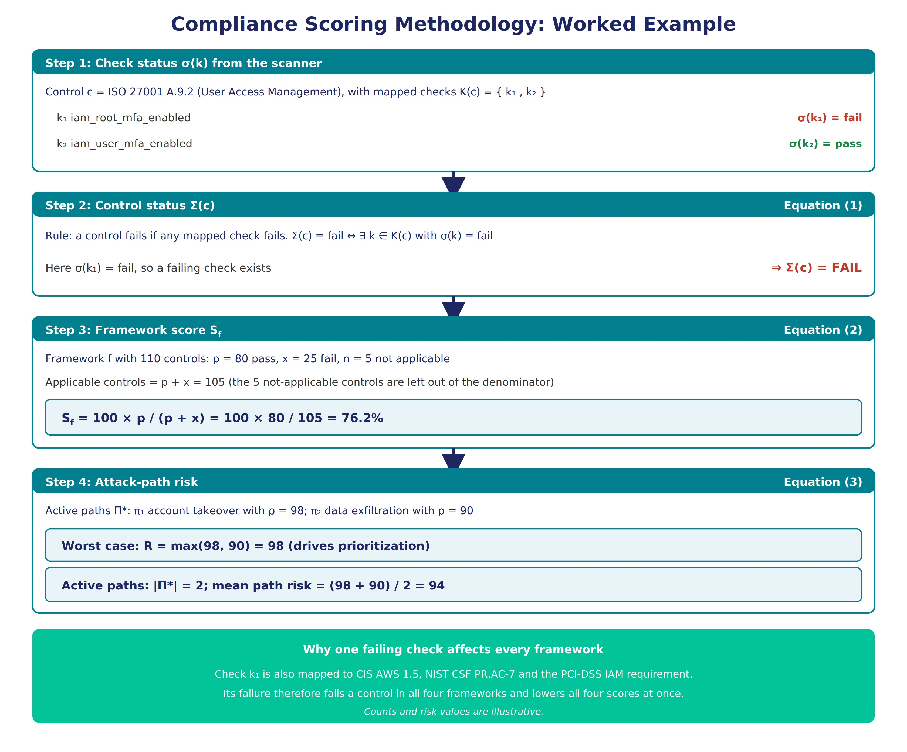
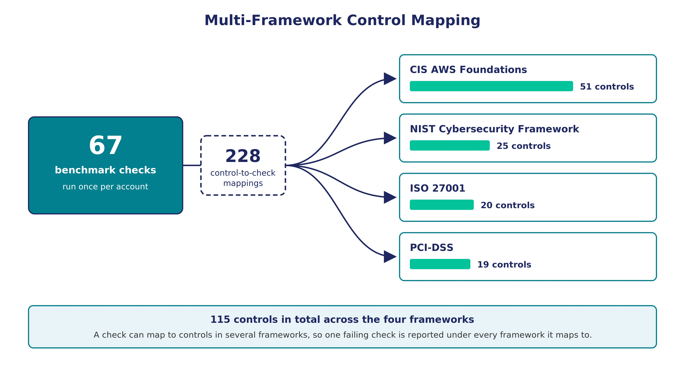
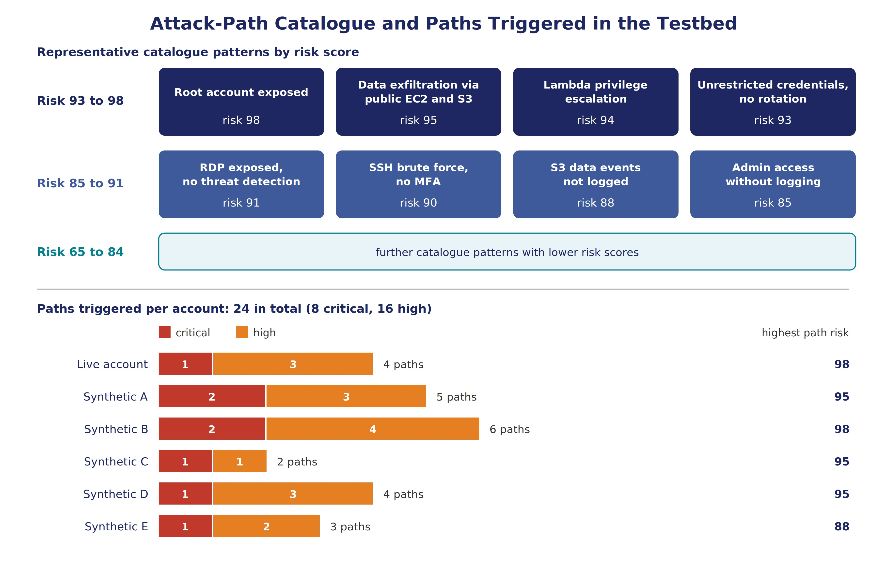

# Multi-Framework CSPM Compliance Dashboard

**Interpretable multi-framework compliance intelligence and attack-path detection for multi-account AWS environments**

     

Master's capstone project (M.S. Cybersecurity, Grand Valley State University, 2026) and the prototype behind the paper *"Interpretable Multi-Framework Compliance Intelligence: Robust Detection of Adversarial Security Misconfigurations in Cloud Systems"* (submitted to ICCWS 2027, under review).

---

## The problem

Most Cloud Security Posture Management (CSPM) tooling has two weaknesses:

1. **Findings are reported one at a time.** The dangerous part is often the combination, for example a privileged credential with no MFA and logging turned off. A flat list of findings hides these attack paths.
2. **Compliance is checked against one framework at a time.** Passing CIS does not mean passing ISO 27001 or PCI-DSS, and opaque risk scores are hard for analysts and auditors to trust.

## What this project does

- **Scans multiple AWS accounts** with [Prowler](https://github.com/prowler-cloud/prowler) and stores every finding with its resource, status and severity.
- **Maps each check to four frameworks at once:** CIS AWS Foundations, ISO 27001, NIST CSF and PCI-DSS. The current mapping covers **115 controls**, **67 technical checks** and **228 check-to-control mappings**.
- **Scores compliance transparently.** A control fails if any mapped check fails. A framework's score is the share of applicable controls that pass, with not-applicable controls left out. Every score can be traced back to the checks and resources behind it.
- **Detects attack paths.** A catalogue of 20+ rule-based patterns flags dangerous combinations of findings. Each pattern carries a base risk score from 65 to 98. For each account the dashboard reports the worst-case path risk, the number of active paths and their mean risk.
- **Tracks posture over time** with trends, recurring findings and remediation progress.



## Features

| Area | Capabilities |
|---|---|
| Dashboard | Executive KPI cards, accounts × frameworks compliance heatmap, trend charts |
| Findings | Filtering, remediation guidance, bulk actions, CSV export, recurring-finding tracking |
| Attack paths | Pattern detection per account, risk scoring, affected resources and remediation steps |
| Reporting | PDF executive reports, email alerts and scheduled summaries |
| Security | JWT authentication, TOTP multi-factor authentication, role-based access control, audit logging, user management |

## Architecture

The prototype has five layers:

1. **Cloud provider:** read-only, role-assumed access to multiple AWS accounts
2. **Scanning:** Prowler 3.12 runs benchmark checks and outputs findings
3. **Service (FastAPI):** framework mapping, scoring, attack-path detection, remediation lookup
4. **Persistence (PostgreSQL):** findings, mappings, scores and audit trail, with JSONB for flexible finding details
5. **Presentation (React):** analyst dashboard, heatmap and attack-path views




## Tech stack

- **Backend:** Python 3.11, FastAPI, SQLAlchemy, Pydantic, PyOTP, ReportLab
- **Scanner:** Prowler 3.12, boto3
- **Database:** PostgreSQL 15
- **Frontend:** React 18, React Router, Recharts, Axios
- **Deployment:** Docker and Docker Compose

## Quick start

Prerequisites: Docker Desktop, Git, and (optional) an AWS account with read-only audit credentials.

```bash
git clone https://github.com/<your-username>/cspm-compliance-dashboard.git
cd cspm-compliance-dashboard

cp .env.example .env        # then fill in your own values; never commit .env
docker compose up -d --build
```

- Frontend: http://localhost:3000
- API: http://localhost:8000
- API docs (Swagger): http://localhost:8000/docs

> Use a dedicated, read-only IAM role (for example `SecurityAudit` + `ViewOnlyAccess`) for scanning. Never use root or admin keys.

## Evaluation (summary)

The prototype was exercised on synthetic multi-account environments plus one live AWS account:

- 677 synthetic resources (S3, IAM, EC2, VPC, Lambda, RDS) with 677 findings (182 failed, 495 passed)
- One live account scan with 67 findings, all failed (the account was deliberately left unhardened)
- 24 attack paths detected across the testbed (8 critical, 16 high; 2 to 6 per account; maximum risk 98)

Synthetic data was used to avoid unplanned cloud costs. These results show that the design works as intended. They do not establish effectiveness on real enterprise estates; that needs a controlled study.

## Limitations and future work

- AWS only. Azure and GCP support is planned.
- Path detection uses fixed-length, rule-based patterns stored relationally. A native graph backend for longer traversals is future work.
- Pattern risk scores are expert-assigned severities, not probabilities.
- Runtime overhead has not been benchmarked.

## Project structure

```
cspm-compliance-dashboard/
├── backend/          # FastAPI app: routers, models, schemas, services
├── frontend/         # React dashboard
├── database/         # schema and seed data
├── docs/             # architecture notes and figures
├── docker-compose.yml
└── .env.example
```

## Author

**Kwaku Gyamfi Boamah**, M.S. Cybersecurity, Grand Valley State University (2026)
ORCID: [0009-0007-6026-0987](https://orcid.org/0009-0007-6026-0987)

## Acknowledgements

Thanks to Dr. Jagadeesh Nandigam and Dr. Vijay Bhuse (College of Computing, GVSU) for academic guidance, and to the Prowler, FastAPI and React open-source communities.

## License

MIT. See [LICENSE](LICENSE).
